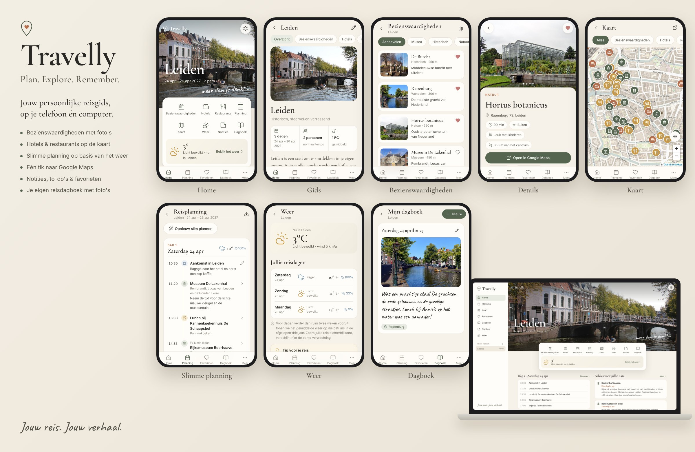

# Travelly – jouw persoonlijke reisgids

*Plan. Explore. Remember.*



Een webapp die werkt op je telefoon én je computer. Vul een stad in, kies je datums en
Travelly laat zien wat er te doen is, maakt een planning en houdt rekening met het weer.

## Wat kan het?

| Onderdeel | Wat doet het? |
|-----------|---------------|
| **Gids** | Voor Leiden een eigen gids met foto's, insider tips en advies voor jullie datums (Keukenhof, Koningsdag, markt op woensdag/zaterdag, musea dicht op maandag…). Voor elke andere stad wordt een gids samengesteld uit Wikipedia en OpenStreetMap. |
| **Bezienswaardigheden** | Met foto's, beschrijving, duur, binnen/buiten en filters (musea, historisch, natuur, bij regen, dagtrips). |
| **Hotels & restaurants** | Met adres, keuken, lunch/diner en filters. Foto's, prijzen en reviews via één tik naar Google Maps. |
| **Kaart** | Alles op de kaart, met je eigen locatie. Tik op een plek voor route of Google Maps. |
| **Slimme planning** | Verdeelt de plekken over de dagen: wat dicht bij elkaar ligt op één dag, musea op regendagen, nooit naar een museum dat dicht is, lunch en diner in de buurt, en een dagtrip als er tijd is. Alles kun je daarna zelf aanpassen. Per dag: *Dagroute in Google Maps*. Exporteer naar je agenda (.ics). |
| **Weer** | Echte verwachting tot ruim twee weken vooruit; verder weg het gemiddelde weer op die datums in de afgelopen drie jaar. |
| **Wie gaan er mee?** | Kies *Met z'n tweeën*, *Gezin*, *Vrienden* of *Alleen*. Bij een gezin vul je de leeftijden van de kinderen in: je ziet dan per plek of het leuk is voor elk kind en of het met de buggy kan, er komt een filter *Met kinderen* en *Spelen* (speeltuinen, kinderboerderij, hertenkamp), en de planning past zich aan (rustiger tempo, speelpauze, middagdutje voor de kleinsten, vroeg eten op kindvriendelijke plekken). |
| **Wat kun je hier doen** | Bij elke bezienswaardigheid een paar concrete dingen om te doen. |
| **Notities & to-do** | Gekleurde notities en een afvinklijstje. |
| **Dagboek** | Schrijf je herinneringen en voeg foto's toe (kiezen of direct een foto maken). |
| **Favorieten** | Tik op het hartje en je vindt het terug, ook op de kaart. |

## Installeren op je telefoon

Open de app in de browser en kies:
- **iPhone (Safari):** deelknop → *Zet op beginscherm*
- **Android (Chrome):** menu ⋮ → *App installeren* of *Toevoegen aan startscherm*
- **Computer (Chrome/Edge):** het installeer-icoontje rechts in de adresbalk

Daarna start Travelly als een echte app, en wat je al eens bekeken hebt werkt ook zonder internet.

## Je gegevens

Reizen, notities en foto's worden **alleen op het apparaat** bewaard waarop je ze maakt.
Wil je een reis op je telefoon én computer? Ga naar *Reis aanpassen → Exporteer reis* en
importeer het bestand op het andere apparaat.

## Starten op je eigen computer

Vanuit de hoofdmap van deze repository:

```
python -m http.server 8888 --bind 127.0.0.1
```

Open daarna **http://127.0.0.1:8888/travelly/**.

## Online zetten

Travelly bestaat alleen uit losse bestanden en heeft geen sleutels of server nodig. Zet de map
`travelly/` op een webserver met HTTPS (of op GitHub Pages) en open het adres op je telefoon.
De Retrospeler in de hoofdmap blijft gewoon werken; Travelly staat er los naast.

## Bronnen

Foto's: Wikimedia Commons (vrije licenties) · Kaart, hotels en restaurants: © OpenStreetMap ·
Weer: Open-Meteo · Iconen: Lucide · Kaartbibliotheek: Leaflet.
Openingstijden en datums van evenementen kunnen veranderen: controleer ze even voor vertrek.
